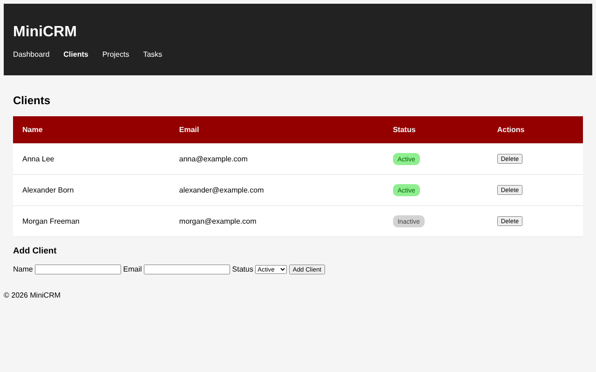

# MiniCRM

A small learning project: the front end of a CRM for tracking clients, written in plain HTML, CSS and JavaScript with no frameworks and no backend.

I'm building it step by step while learning web development. Each stage adds one real feature; right now the **Clients** page is fully interactive, the other pages are static layouts.



## Tech stack

- HTML5 (semantic markup, forms with built-in validation)
- CSS3
- Vanilla JavaScript (DOM API, events, `localStorage`)
- Git / GitHub

## Features

**Working**

- Clients table rendered from a JavaScript array
- Add a client through a form (name, email, status)
- Delete a client
- Clients are saved to `localStorage`, so they survive a page reload
- Status badges (Active / Inactive)

**Static layout only (no logic yet)**

- Login page (`index.html`): the form does not authenticate
- Dashboard (`dashboard.html`): the numbers are hard-coded

## Getting started

No build step and no dependencies.

```bash
git clone https://github.com/roflplayer11/minicrm.git
cd minicrm
```

Then open `clients.html` in a browser, or serve the folder (for example with the VS Code Live Server extension).

To reset the data to the three demo clients, clear `localStorage` for the page in DevTools (Application → Local Storage).

## Project structure

```
index.html       Login page (layout)
dashboard.html   Dashboard (layout, static data)
clients.html     Clients page
clients.js       Clients logic: render, add, delete, persist
style.css        Shared styles
docs/            Screenshots for this README
```

## Roadmap

- [ ] Projects and Tasks pages (links in the menu are placeholders for now)
- [ ] Edit a client
- [ ] Search and filter by status
- [ ] Dashboard counters calculated from real data
- [ ] REST API on Node.js + Express, data in a database instead of `localStorage`
- [ ] Real authentication

## Author

Veaceslav, [@roflplayer11](https://github.com/roflplayer11)
